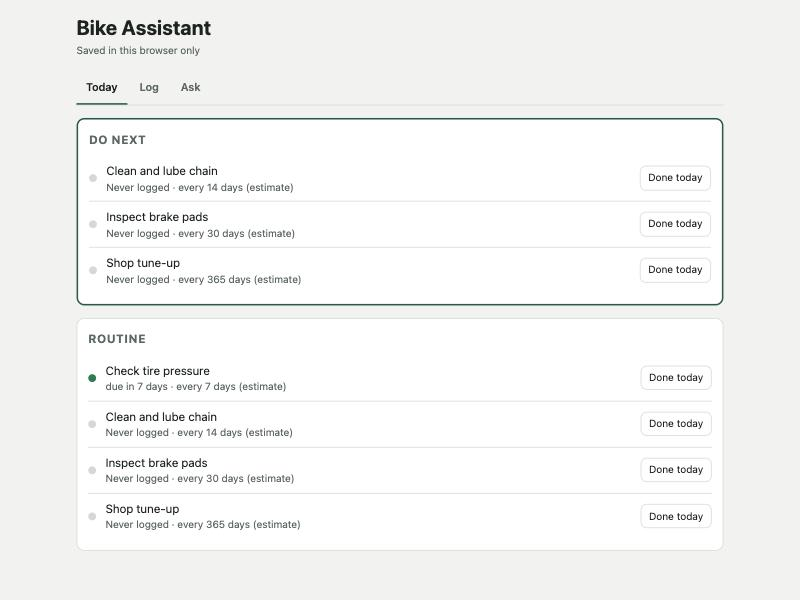

# Claude Life Assistants

Three personal AI assistants I built with Claude, each a single web page that remembers my data and can ask Claude for help:

| Assistant | What it does | Usefulness so far |
|---|---|---|
| **Virtual Car** (my 2015 Nissan Rogue) | Service logbook from every receipt, "watch list" of known problems, 3D model you tap to learn parts, dent tracker, dashboard-light guide, monthly brief | **8/10**: caught a shop billing a different fluid service than quoted, a wrong tire pressure, and an odometer mismatch |
| **Wardrobe & Stylist** | Every piece of clothing tagged (color, formality, fit, care), outfit builder with live checks, worn-outfit log, planner | **8/10**: used most; 18 outfits logged and reviewed Oct 10 – Nov 9 |
| **Virtual Room** | Drag-and-drop floor plan + 3D view, upkeep checklist, weekly photo check-in rated by Claude, "where things go" index | **4/10**: the layout planner was useful once; the weekly loop hasn't started |

The honest scoring and what drove it are in [docs/usefulness-review.md](docs/usefulness-review.md). Short version: **an assistant is only as useful as the data you keep feeding it.** The car and closet get new data regularly (5 shop visits and 18 outfits logged since mid-October); the room hasn't had any yet.

---

## Build your own (one sitting, my estimate: 1–2 hours)

You do not need to write code. Claude writes it; you supply photos, receipts and measurements, and you decide what goes in.

**You need:** a Claude account with Artifacts. I used the Claude desktop app. Three features depend on what your Claude setup supports:

| Feature | Uses | If you don't have it |
|---|---|---|
| Data saved across devices | Artifact `db` capability | The template saves in your browser instead (and can export JSON) |
| "Ask Claude" box inside the page | Artifact `sample` capability | Ask in chat instead, pasting the page's data |
| Claude adding records from a photo you send in chat | Claude reading/writing the artifact's database (works in the Claude desktop app) | Ask Claude to give you the record as text, then type it into the page's form |

Which capabilities you get depends on your plan and organization settings.

1. **Pick one domain.** Car, closet, room, bike, plants, a pet, a home lab. Start with one. Three at once is how the room one went stale.
2. **Gather the raw material** (20 min). See the checklist in the prompt file for your domain:
   - Car: every receipt or invoice you can find, your CARFAX or service history, dashboard photos, photos of dents and warning lights.
   - Closet: one flat photo per item on a plain background, tag photos (brand, size, fabric, care).
   - Room: tape-measure numbers, a photo from each corner, a photo from the doorway.
3. **Paste the build prompt** from [`prompts/`](prompts/) into a new Claude chat with your material attached. Answer its questions.
4. **Publish** it as an Artifact when Claude asks (or say "publish this as an artifact with saved data").
5. **Run the loop for 4 weeks** using the weekly prompts at the bottom of each prompt file. This is the part that makes it useful.
6. **Score it** with [docs/rubric.md](docs/rubric.md) after 4 weeks. Cut tabs you never opened.

## Or start from the template (10 minutes)

[template/starter.html](template/starter.html) is a working, minimal assistant: a routine with computed due dates, a "Do next" box, a records log, and an Ask Claude box. It's set up as a bike assistant as an example.



**Try it locally:**

```bash
git clone https://github.com/5chengzhi/claude-life-assistants.git
```

```bash
open claude-life-assistants/template/starter.html
```

(On Windows or Linux, double-click the file instead.) Data saves in that browser.

**Make it yours with Claude:** attach `starter.html` to a new chat and paste:

```text
Adapt this starter into an assistant for [my bike / my plants / my dog / my home lab].
Keep its structure: CONFIG at the top, storage that uses the Artifact database when available, computed "Do next".
Replace CONFIG.tasks with real intervals for [subject] and tell me the source for each interval, or mark it "estimate".
Then publish it as an Artifact with capabilities {db, sample}, with every db collection readable and writable only by editors.
```

---

## What's in here

```
README.md                    You are here
docs/
  how-it-was-built.md        The actual build process, step by step, with what worked and what didn't
  architecture.md            How a single-file assistant is structured: data, storage, AI calls, 3D
  usefulness-review.md       Honest ratings of my three assistants, with the evidence
  rubric.md                  The 10-point scorecard to rate your own
  privacy.md                 What not to put in, and how sharing works
  img/                       Screenshots
prompts/
  00-shared-rules.md         Rules to paste into every build (keeps Claude honest and the page usable)
  01-car-assistant.md        Build prompt + weekly prompts for a car assistant
  02-room-assistant.md       Build prompt + weekly prompts for a room assistant
  03-wardrobe-assistant.md   Build prompt + weekly prompts for a wardrobe/stylist
template/
  starter.html               Minimal working assistant; works offline, lights up inside Claude
  sample-data/*.json         Anonymized example records showing the data shapes
LICENSE                      MIT
```

The original three pages are not in this repo: they hold my personal records (VIN, receipts, photos, people's names). Everything here is the method, the prompts and a clean template. See [docs/privacy.md](docs/privacy.md).

## Credits

Built by Cheng Wu Li with [Claude](https://claude.ai). The 3D views use [three.js](https://threejs.org) r128 and the charts use [Chart.js](https://www.chartjs.org) 4.4.1.
